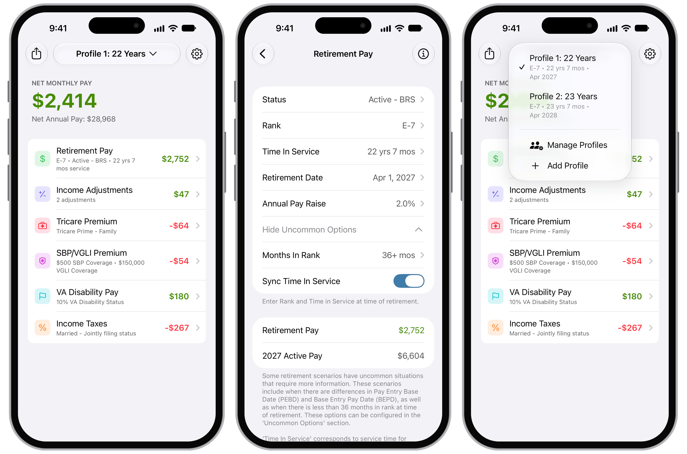
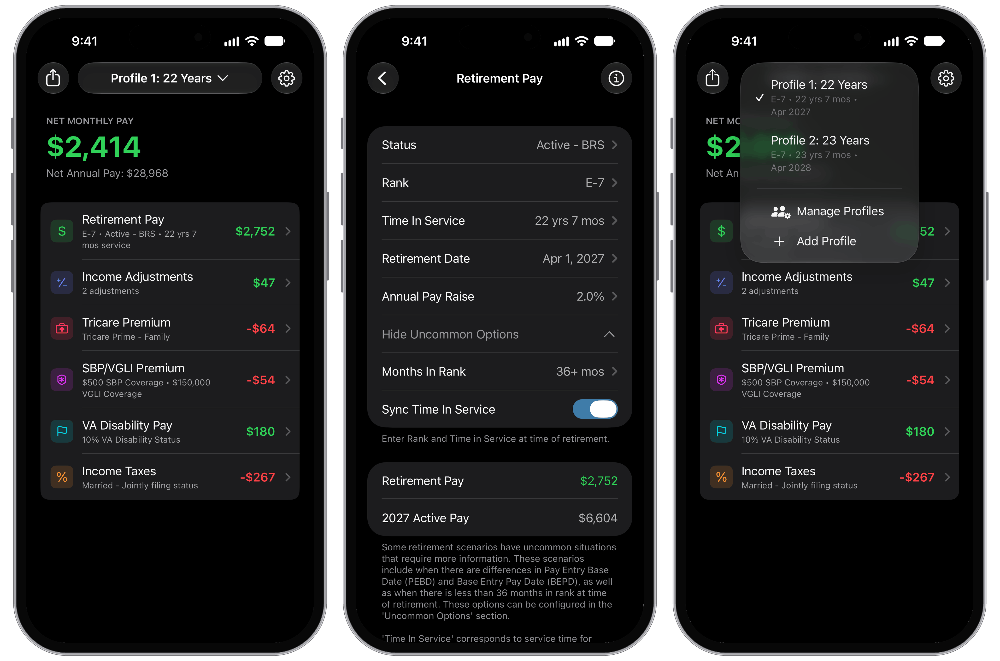

    <h1 class="app-name vt-mil-title">Military Retirement</h1>
    

        

            <a href="https://apps.apple.com/app/apple-store/id563082328?pt=1614325&ct=military-retirement-webpage&mt=8" target="_blank">
                 (opens in new tab)
            </a>
        

        

            <a href="https://play.google.com/store/apps/details?id=com.LynnfieldLLC.MilitaryRetire" target="_blank">
                 (opens in new tab)
            </a>
        

    

    
    

        Military Retirement is an application intended to assist military personnel from all branches of military service by informing them of their benefits upon retirement from military service. Military Retirement gives assistance by calculating an estimation of retirement pay based on your personal information. Military Retirement incorporates four years of pay tables to provide the highest degree of accuracy. Compare multiple scenarios to determine which retirement option is best for you.
    

    <h2 class="app-features-title">Features</h2>
    <ul class="feature-list">
        <li><strong>Retirement pay</strong>Estimate your monthly pension from your rank, time in service, retirement date, and retirement system.</li>
        <li><strong>Compare scenarios</strong>Save multiple profiles to find the retirement date and options that suit you best.</li>
        <li><strong>Survivor &amp; life coverage</strong>Estimate SBP and VGLI premiums and what your survivors would receive.</li>
        <li><strong>TRICARE</strong>Compare coverage options and their monthly premiums.</li>
        <li><strong>VA disability pay</strong>Factor in disability compensation based on your rating, marital status, and dependents.</li>
        <li><strong>Income taxes</strong>Estimate federal and state taxes based on your filing status and residence.</li>
        <li><strong>Income &amp; bills</strong>Add extra income and recurring bills for a fuller picture of your budget.</li>
    </ul>

    
    

